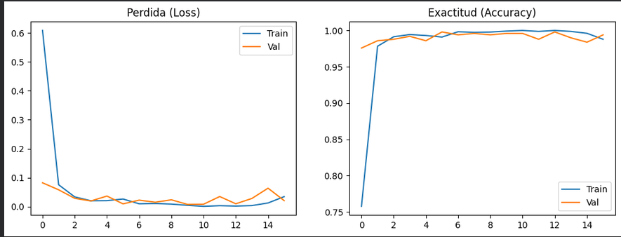
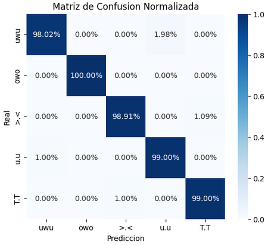
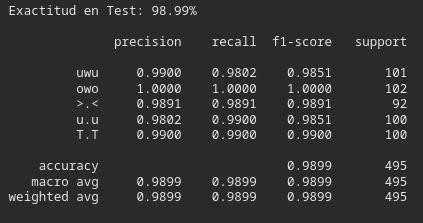

# KaomojiNet
Clasificación de emoticones gestuales (Kaomoji) mediante Redes Neuronales Convolucionales (CNN)

## Integrantes
- Diego Pineda
- Jesus Santa Cruz
- Mateo Torres
- Ivan Urbano

## Notebook
[![Link al notebook]](https://colab.research.google.com/drive/1YU0vfe6_6fMhZtoCjd1luKuFzv0wqhFH?usp=sharing)

## Aplicacion KaomojiNet
[![Link (temporal) a la app]](https://kaomojinet-production.up.railway.app/)

## Categorías
- `uwu`: Ternura  
- `owo`: Sorpresa 
- `>.<`: Vergüenza  
- `u.u`: Resignación
- `T.T`: Llanto

## Ejecución local

```bash
source venv/bin/activate
pip install -r requirements.txt
python3 main.py
```

Abrir en el navegador: `http://localhost:5000`.

- Borrar: Limpia el cuadro
- Enviar: Guarda el dibujo
- Predecir: Clasifica el dibujo
- Generación del dataset compilado: `http://localhost:5000/prepare` empaqueta todas las imágenes recolectadas en `X.npy` e `y.npy`

## Entrenamiento

1. Abrir el notebook en [Google Colab](https://colab.research.google.com/drive/1YU0vfe6_6fMhZtoCjd1luKuFzv0wqhFH?usp=sharing)
2. Montar Google Drive para leer `X.npy` e `y.npy`
3. Ejecutar todas las celdas para entrenar la red convolucional

## Métricas y Resultados

- **Exactitud global (Test Accuracy):** **98.99%**

### Curvas de Aprendizaje (Pérdida y Exactitud)


### Matriz de Confusión Normalizada


### Reporte de Clasificación

